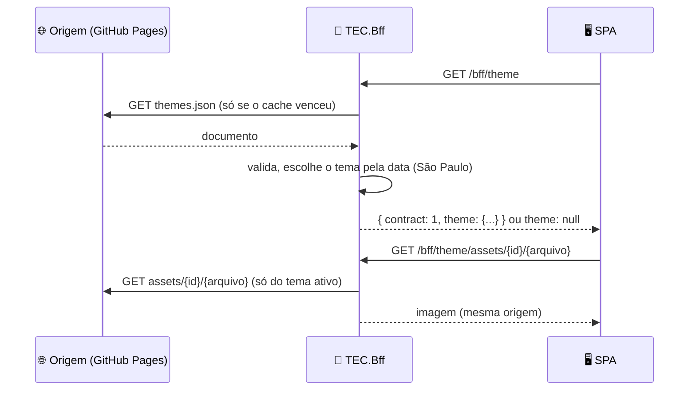

<div align="center">

</div>

# 🎄 Tema sazonal no TEC.Bff

Para quem opera o BFF e quer trocar a identidade visual do ecossistema (Natal, por exemplo) **sem republicar as SPAs**. A decisão e o modelo de ameaças estão no ADR 0009 da família FRT da Doutrina e no [ADR 0002 deste repositório](adr/0002-tema-sazonal-por-manifesto-fechado.md); o manifesto e a aplicação no navegador, na [documentação do pacote `@tudoemcodigo/theme`](https://github.com/tudoemcodigo/lib-tec-web/blob/main/docs/tema-sazonal.md).

## 📑 Sumário

- [🧭 Visão geral](#-visão-geral)
- [⚙️ Ligar](#️-ligar)
- [🔌 Contrato](#-contrato)
- [🛡️ O que é recusado](#️-o-que-é-recusado)
- [❓ Perguntas frequentes](#-perguntas-frequentes)

## 🧭 Visão geral



Legenda: seta cheia = pedido; tracejada = resposta. O navegador nunca fala com a origem: a CSP da SPA não precisa de nenhuma origem nova (`img-src 'self'`).

## ⚙️ Ligar

O recurso vem **desligado**. Sem `Theme.Url`, `GET /bff/theme` responde `{ "contract": 1, "theme": null }` e a SPA fica no tema padrão.

```json
{
  "Bff": {
    "Theme": {
      "Url": "https://tudoemcodigo.github.io/themes/themes.json"
    }
  }
}
```

```csharp
builder.Services.AddTecSecurity(builder.Configuration, security => security
    .AddAspNetCore()
    .AddOpenIdConnectWebLogin("Web", /* ... */)
    .AddTecBff(options =>
    {
        options.ApiBaseAddress = new Uri("https://api.exemplo.com");
        options.SpaRootPath = "dist";
        options.Theme.Url = new Uri("https://tudoemcodigo.github.io/themes/themes.json");
    }));
```

As demais opções (`Theme.CacheTtl`, `FetchTimeout`, `StaleMaxAge`, `MaxDocumentBytes`, `MaxAssetBytes`, `AllowPrivateNetworks`) estão na tabela do [README](https://github.com/tudoemcodigo/lib-tec-bff/blob/main/README.md#-o-que-tem-dentro). Opção inválida derruba a subida.

## 🔌 Contrato

`GET /bff/theme` (público, só leitura, `Cache-Control: no-store`):

```json
{
  "contract": 1,
  "theme": {
    "id": "christmas-2026",
    "tokens": { "color-accent": { "light": "#b3001b", "dark": "#ff9aa6" } },
    "assets": { "banner": "/bff/theme/assets/christmas-2026/banner.png" },
    "animation": "snow"
  }
}
```

A janela do tema é avaliada **no servidor**, no calendário de `America/Sao_Paulo` (o relógio da SPA não decide). Com janelas sobrepostas vence o tema de início mais recente; no empate, o menor `id`.

## 🛡️ O que é recusado

Qualquer um destes deixa a SPA no tema padrão (ou no último documento válido, por até `Theme.StaleMaxAge`):

| Situação | Resultado |
|---|---|
| Origem responde diferente de 200 (inclusive redirecionamento) | falha; nenhum redirecionamento é seguido |
| Documento acima de `MaxDocumentBytes`, com ou sem `Content-Length` | falha |
| Origem não responde em `FetchTimeout` | falha |
| JSON inválido, comentário, vírgula sobrando, UTF-8 inválido, chave duplicada, profundidade acima de 8 | documento recusado |
| Campo desconhecido, token protegido (erro, aviso, sucesso), cor fora de `#rrggbb`, data inexistente, `id` duplicado | documento recusado |
| Asset que não é do tema ativo, com caminho fora do padrão ou com `%` | 404 |
| Asset cujo conteúdo não é a imagem que a extensão declara, ou acima de `MaxAssetBytes` | 404 |
| Destino da busca em endereço não público | falha antes de abrir a conexão |

Um documento ruim **nunca substitui** o último documento bom.

## ❓ Perguntas frequentes

**O que acontece se o GitHub Pages cair?** O BFF segue servindo o último documento válido por até 24 horas (`Theme.StaleMaxAge`); depois, "sem tema". Busca que falha não é repetida por 30 s.

**Preciso de token para a origem?** Não: o documento é público e a URL não aceita credencial nem consulta.

**Como testo localmente?** Use `Theme.AllowPrivateNetworks = true` com uma URL `http://localhost:...` (só desenvolvimento).
